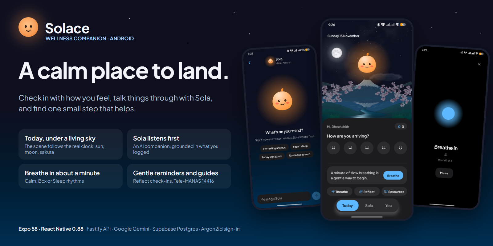
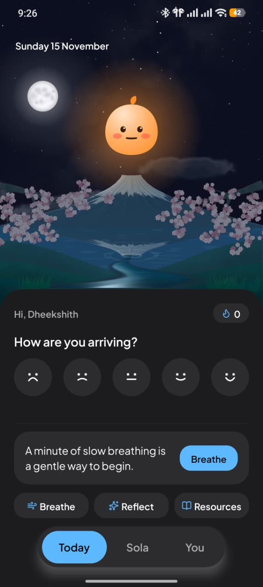
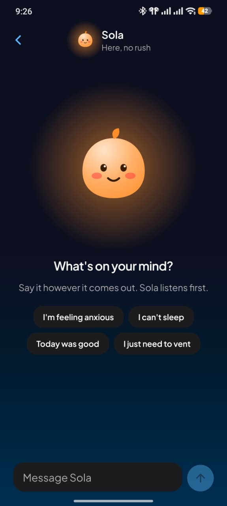
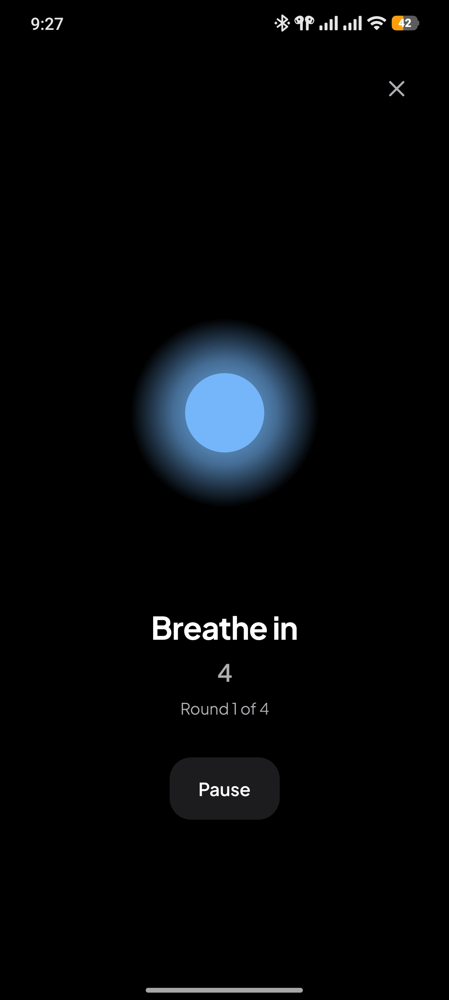
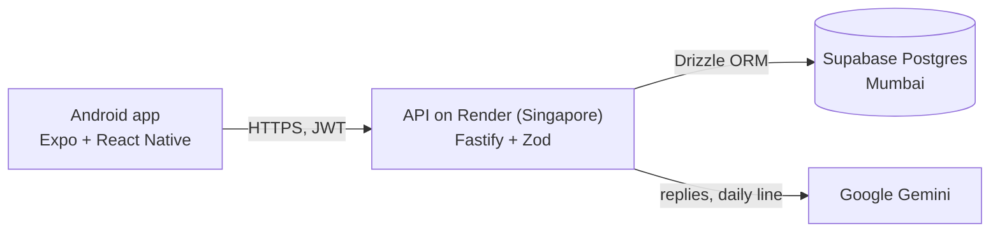

# Solace

**A calm place to land.** Solace is an Android wellness app. You check in with how you feel, talk things through with Sola, and find one small step that helps.

Solace is a friendly guide, not a therapist, and it is not a substitute for professional help.

**Website:** [dheekshith-r.github.io/solace](https://dheekshith-r.github.io/solace/) · **Download:** [Solace 1.0.0 for Android (APK, 52 MB)](https://github.com/dheekshith-r/solace/releases/latest)

## The app

<table>
  <tr>
    <td width="33%"></td>
    <td width="33%"></td>
    <td width="33%"></td>
  </tr>
  <tr>
    <td><b>Today.</b> A painted sky follows the real clock: the sun and moon move, with sakura and a stream. Tap one of 5 moods. A mood tapped offline is sent later.</td>
    <td><b>Sola.</b> An AI companion (Google Gemini) that listens first. Replies stream in. Sola never claims details that you did not log.</td>
    <td><b>Breathe.</b> Calm (in 4, hold 4, out 6), Box (4-4-4-4) or Sleep (4-7-8), 4 rounds, about a minute.</td>
  </tr>
</table>

## Features

- **Reflect:** three short check-ins (Mood, Anxiety relief, Self-talk), 4 questions each. The result names how you are doing ("Steady ground", "A bit stretched" or "Carrying a lot") and suggests 3 small moves. It is a check-in, not a diagnosis.
- **Reminders:** a mood check-in, a daily affirmation, a breathing break, and up to 20 reminders of your own, each at its own time.
- **Resources:** short guides (Mindfulness 101, Anxiety toolkit, Beating the blues, Self-esteem reset, Sleep wind-down) and **Get help now**: Tele-MANAS 14416 (free, 24 hours) and emergency 112. The helpline also shows with no network.
- **You:** a check-in calendar, a 14-day mood trend, a day streak, levels and XP (given by the server only), your name, reminders, appearance (Sky, Follow system, Always light, Always dark), privacy and data.
- **Safety first:** every typed message gets a crisis check before any AI call. On a match, the AI is not called. Solace replies with a fixed caring message and shows the helpline.
- **Your data:** delete all chats, turn off "Personalize with my history", or delete your account and every row that belongs to it.
- **18+ only:** sign-up asks you to confirm your age.

## How it is built



| Part | Choice |
|---|---|
| App | Expo 58, React Native 0.88, React 19.3, expo-router, Reanimated 4, Skia (the painted sky), TanStack Query, zustand, MMKV |
| API | Fastify 5, Zod 4, Drizzle ORM, `@google/genai`, helmet, rate limits |
| Sign-in | Email and password, Argon2id hashes, 15-minute access tokens, rotating refresh tokens stored only as hashes |
| Database | Supabase Postgres (Mumbai) |
| Hosting | Render, Singapore region, auto-deploy from `main` |
| Tests | Vitest (API), Jest with jest-expo (app), Maestro flows on a real phone |

## Branches

| Branch | What it holds |
|---|---|
| `main` | The API and the shared package. Render deploys this branch. |
| `app-build` | The full app: mobile, API and shared code. |

## Run it

You need Node 22.13 or newer.

```bash
npm install
cp apps/api/.env.example apps/api/.env      # fill in DATABASE_URL, MIGRATION_DATABASE_URL, JWT_SECRET, GEMINI_API_KEY
npm run db:migrate -w @solace/api
npm run dev -w @solace/api                  # API on http://localhost:3000, check /health
```

Checks for the whole repo:

```bash
npm run test
npm run typecheck
npm run lint
```

To build the Android APK, use `build-apk.ps1` on the `app-build` branch. It needs JDK 17, the Android SDK and `apps/mobile/.env` with `EXPO_PUBLIC_API_URL`.

## Security

Read [SECURITY.md](./SECURITY.md). Report problems in private, never in a public issue.

## Contributing

Ideas and bug reports are welcome: read [CONTRIBUTING.md](./CONTRIBUTING.md).

## License

[MIT](./LICENSE).
